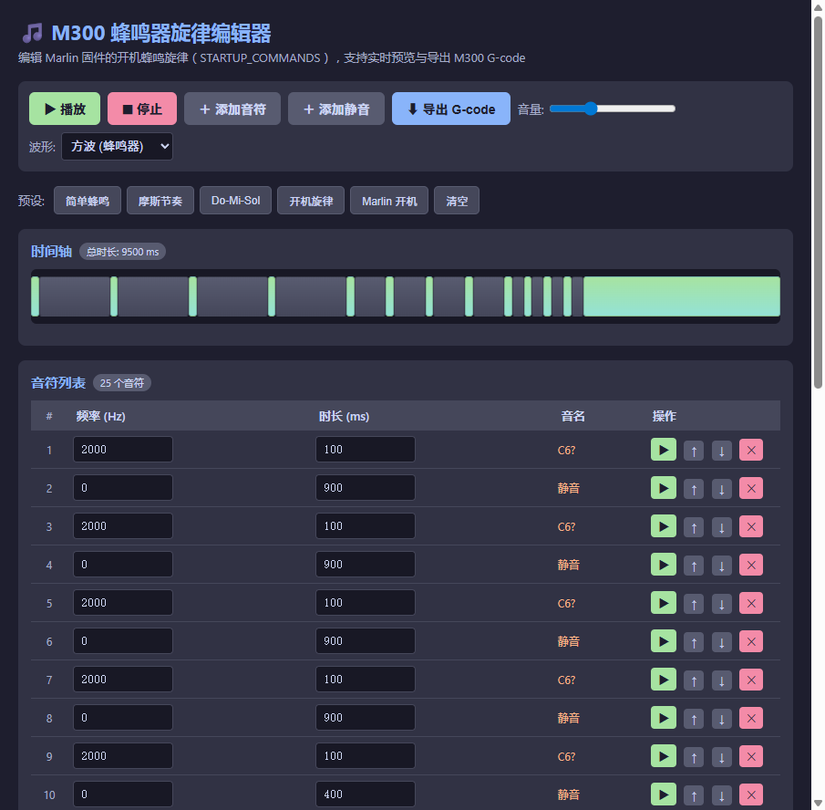
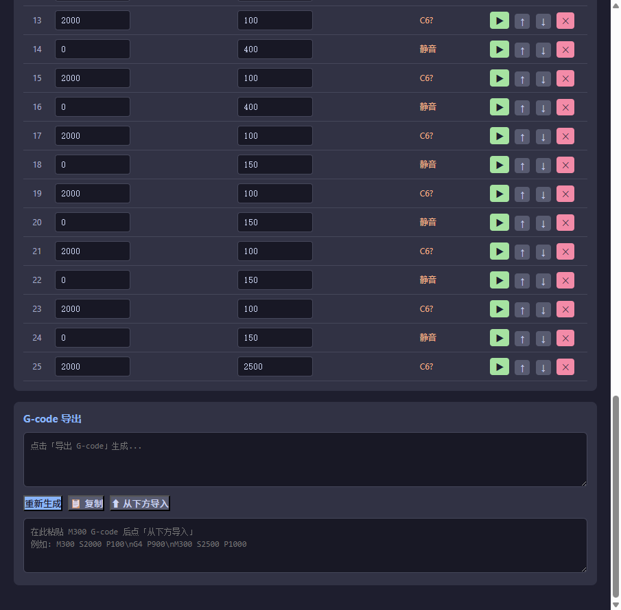
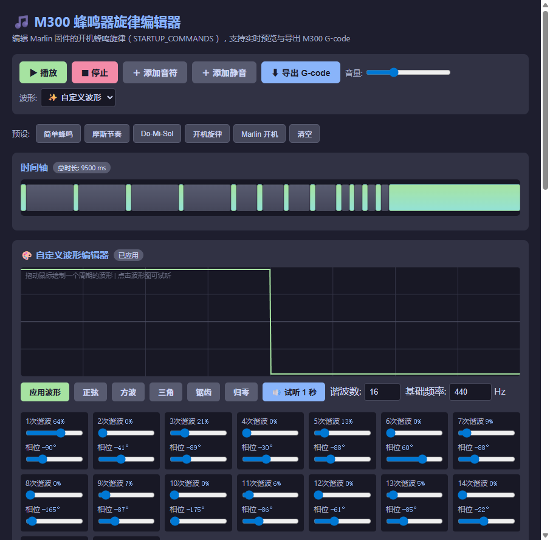

# M300 蜂鸣器旋律编辑器 — 使用教程

本工具是一个纯网页（HTML + JavaScript）的旋律编辑器，专门用于调试 **Marlin 固件的开机蜂鸣声音**（`STARTUP_COMMANDS`）。

你可以在电脑上**实时预览**旋律效果，编辑满意后导出为 M300 G-code，刷入固件即可听到新的开机音。

---

## 目录

- [一、工具简介](#一工具简介)
- [二、打开编辑器](#二打开编辑器)
- [三、界面总览](#三界面总览)
- [四、快速上手：导入并播放](#四快速上手导入并播放)
- [五、编辑旋律](#五编辑旋律)
- [六、自定义波形](#六自定义波形)
- [七、导出到固件](#七导出到固件)
- [八、导入固件现有旋律](#八导入固件现有旋律)
- [九、常见问题](#九常见问题)
- [十、速查表](#十速查表)

---

## 一、工具简介

**适用场景：**
- 修改 LumenPnP / Marlin 固件的开机蜂鸣旋律
- 在电脑上试听不同频率、节奏组合的效果
- 快速生成 M300 G-code 序列

**核心能力：**

| 功能 | 说明 |
|------|------|
| 🎵 旋律编辑 | 增删改音符，调节频率(Hz)和时长(ms) |
| 🔊 实时预览 | 用电脑扬声器播放，支持音量/波形调节 |
| 📊 时间轴可视化 | 彩色方块显示每个音符的时长占比 |
| 🎨 自定义波形 | 手绘波形 / 谐波滑块调节，模拟不同音色 |
| 📋 G-code 导入导出 | 与固件 `STARTUP_COMMANDS` 格式互通 |
| ⚡ 预设旋律 | 内置 4 种旋律一键加载，含固件当前开机音 |

> 💡 **重要说明：** 网页端的"自定义波形"仅用于**电脑上模拟听感**。实际烧录到 Marlin 固件后，压电蜂鸣器只能输出**方波**，硬件不支持自定义波形——M300 指令只控制**频率**和**时长**。

---

## 二、打开编辑器

编辑器是单个 HTML 文件，**无需安装任何依赖**。

### 方式 A：本地 HTTP 服务（推荐）

在项目根目录打开终端，启动静态服务器：

```bash
python -m http.server 8765
```

然后浏览器访问：

```
http://127.0.0.1:8765/m300_editor/index.html
```

### 方式 B：直接双击打开

在文件管理器中找到 `m300_editor/index.html`，双击用浏览器打开即可。

> ⚠️ **首次播放没声音？** 浏览器有自动播放策略，需要先点击页面任意位置（如「播放」按钮）后才能发声。如果第一次没声音，再点一次即可。

---

## 三、界面总览

打开编辑器后，你会看到如下界面：



界面从上到下分为 5 个区域：

| 区域 | 功能 |
|------|------|
| **顶部工具栏** | 播放、停止、添加音符、导出、音量、波形选择 |
| **预设旋律栏** | 一键加载内置旋律（固件当前开机音 / 旧版摩斯 / 简单蜂鸣 / Do-Mi-Sol），与 `Configuration_adv.h` 的 `STARTUP_COMMANDS` 对照维护 |
| **时间轴** | 彩色方块可视化每个音符的时长占比 |
| **音符列表** | 表格形式编辑每个音符的频率和时长 |
| **G-code 导出区** | 生成/复制导出文本，或粘贴导入 G-code |

选择「**✨ 自定义波形**」时，时间轴下方还会展开**波形编辑器**区域。

---

## 四、快速上手：导入并播放

### 步骤 1：找到导入框

滚动到页面底部的「G-code 导出」区域，你会看到**两个文本框**：



- **上方文本框**：导出框（点击"导出 G-code"后生成结果）
- **下方文本框**：导入框（占位符提示"在此粘贴 M300 G-code 后点「从下方导入」"）

### 步骤 2：粘贴 G-code

把 M300 代码粘贴到**下方的导入框**。例如从固件配置文件复制的**当前开机音**（`Configuration_adv.h` 第 3858 行）：

```
M300 S523 P140\nG4 P90\nM300 S659 P140\nG4 P90\nM300 S784 P140\nG4 P90\nM300 S1046 P420
```

> 注意：`\n` 是字面量（反斜杠 + n），不是真实换行。导入时会自动解析。

### 步骤 3：点击「⬆ 从下方导入」

音符列表会自动填入：

| # | 频率(Hz) | 时长(ms) | 音名 |
|---|---------|---------|------|
| 1 | 523     | 140     | C5   |
| 2 | 0       | 90      | 静音 |
| 3 | 659     | 140     | E5   |
| 4 | 0       | 90      | 静音 |
| 5 | 784     | 140     | G5   |
| 6 | 0       | 90      | 静音 |
| 7 | 1046    | 420     | C6   |

- `M300 S<频率> P<时长>` → 发声
- `G4 P<时长>` → 静音停顿

### 步骤 4：点击「▶ 播放」

即可听到旋律。播放时时间轴上有**红色进度条**指示当前播放位置。

---

## 五、编辑旋律

### 5.1 添加音符

| 按钮 | 效果 |
|------|------|
| 「**＋ 添加音符**」 | 添加一个默认 2000Hz / 100ms 的音符 |
| 「**＋ 添加静音**」 | 添加一段默认 300ms 的静音（对应 G4 指令） |

### 5.2 修改音符

直接在表格中修改：

- **频率 (Hz)**：输入 0~20000 之间的数值（0 表示静音）
- **时长 (ms)**：输入 1~10000 之间的数值

回车或点击别处即生效，音名列会自动更新（如 C4、A4 等）。

### 5.3 删除和排序

每行右侧有 4 个操作按钮：

| 按钮 | 功能 |
|------|------|
| ▶ | 单独试听这一个音符 |
| ↑ | 上移一位 |
| ↓ | 下移一位 |
| ✕ | 删除该音符 |

### 5.4 时间轴操作

时间轴上每个**彩色方块**代表一个音符，宽度按时长比例显示：

- 🟢 绿色 = 发声音符
- ⚫ 灰色 = 静音

**点击任意方块**可单独试听该音。

---

## 六、自定义波形

> 💡 自定义波形仅用于**电脑端预览听感**，固件蜂鸣器只支持方波。

### 6.1 打开波形编辑器

在顶部「波形」下拉框中选择 **「✨ 自定义波形」**，波形编辑器会展开：


### 6.2 方式一：手绘波形

在波形画布上**按住鼠标左键拖动**，即可绘制一个周期的波形。松手后自动应用。

画布说明：
- 横向 = 一个周期（0% ~ 100%）
- 纵向 = 振幅（上半正、下半负）
- 中线 = 零电平

### 6.3 方式二：快捷预设

画布下方有快捷按钮，一键生成标准波形：

| 按钮 | 波形 | 特点 |
|------|------|------|
| 正弦 | 平滑正弦波 | 听感最柔和 |
| 方波 | 压电蜂鸣器真实波形 | 听感最"硬" |
| 三角 | 三角波 | 介于两者之间 |
| 锯齿 | 锯齿波 | 听感尖锐 |
| 归零 | 全 0 | 静音基线 |

点击「**方波**」后画布效果如下：



### 6.4 方式三：谐波滑块

画布下方会自动生成 **1~N 次谐波**的调节滑块（N 由"谐波数"控制，默认 16，最大 64）。

每个谐波有两个滑块：

- **幅度滑块**（0~100%）：控制该次谐波的强度
- **相位滑块**（-180°~180°）：控制该次谐波的相位

拖动滑块后，画布会实时重绘合成波形，并自动更新 PeriodicWave。

### 6.5 试听

- 点「**🔊 试听 1 秒**」用当前波形以指定基础频率播放
- 可修改「基础频率」输入框（20~4000 Hz）

### 6.6 应用

绘制或调完滑块后：
- 松手会**自动应用**
- 也可手动点「**应用波形**」按钮

应用后，播放整个旋律时所有音符都使用这个自定义波形发声。

---

## 七、导出到固件

### 步骤 1：生成 G-code

编辑好旋律后，点「**⬇ 导出 G-code**」按钮，上方导出框会生成：

```
M300 S2000 P100\nG4 P900\nM300 S2500 P1000
```

### 步骤 2：复制

点「**📋 复制**」按钮，或手动选中复制。

### 步骤 3：替换固件配置

打开 `Marlin/Configuration_adv.h`，找到第 3858 行附近：

```cpp
#define STARTUP_COMMANDS "M300 S523 P140\nG4 P90\nM300 S659 P140\nG4 P90\nM300 S784 P140\nG4 P90\nM300 S1046 P420"
```

把**引号内**的内容替换成你复制的 G-code，保存文件。

### 步骤 4：编译烧录

用 PlatformIO 重新编译并烧录固件，开机即可听到新旋律。

---

## 八、导入固件现有旋律

如果想在固件当前开机音的基础上修改：

1. 打开 `Marlin/Configuration_adv.h`
2. 找到 `STARTUP_COMMANDS`，**复制引号内的全部内容**
3. 粘贴到编辑器的**下方导入框**
4. 点「**⬆ 从下方导入**」
5. 修改后重新导出、替换回去

---

## 九、常见问题

### Q1：播放没声音？

**排查清单：**
- [ ] 系统音量是否开启？
- [ ] 浏览器标签页是否被静音？（标签页上有小喇叭图标）
- [ ] 是否先点击过页面？（浏览器自动播放策略）
- [ ] 再点一次「播放」试试

### Q2：导入后音符不对？

**检查 G-code 格式：**
- 正确：`M300 S2000 P100` 或 `G4 P900`
- `\n` 必须是字面量（反斜杠+n），不能是真实换行
- 频率必须是整数（如 `S2000`，不是 `S2000.5`）

### Q3：自定义波形在固件上没效果？

固件的**压电蜂鸣器只能输出方波**，自定义波形仅用于电脑端预览。M300 指令只控制频率和时长，与波形无关。

### Q4：改了波形听起来没变化？

- 谐波数设太小（<4）会丢失细节，可调大「谐波数」
- 方波/正弦在高频（>2000Hz）下听感差异小，建议用 200~800Hz 试听
- 确认已点「应用波形」

### Q5：导出的 G-code 怎么用？

直接把导出文本替换到 `Configuration_adv.h` 的 `STARTUP_COMMANDS` 引号内，重新编译烧录即可。

---

## 十、速查表

### 操作速查

| 操作 | 方式 |
|------|------|
| 播放全部 | 顶部 ▶ 播放 |
| 停止播放 | ⏹ 停止 |
| 单音试听 | 音符行 ▶ 按钮 / 时间轴方块 |
| 添加音符 | ＋ 添加音符 |
| 添加静音 | ＋ 添加静音 |
| 删除音符 | 行尾 ✕ 按钮 |
| 上移/下移 | 行尾 ↑ / ↓ 按钮 |
| 导入 G-code | 粘贴到下方框 → ⬆ 从下方导入 |
| 导出 G-code | ⬇ 导出 G-code → 📋 复制 |
| 自定义波形 | 波形下拉选「自定义」→ 绘制/调滑块 → 应用 |

### G-code 指令速查

| 指令 | 含义 | 示例 |
|------|------|------|
| `M300 S<freq> P<dur>` | 以指定频率发声 | `M300 S2000 P100` |
| `G4 P<dur>` | 静音停顿 | `G4 P900` |

### 常用音名频率对照表

| 音名 | 频率(Hz) | 音名 | 频率(Hz) |
|------|---------|------|---------|
| C4 | 261.63 | A4 | 440.00 |
| D4 | 293.66 | B4 | 493.88 |
| E4 | 329.63 | C5 | 523.25 |
| F4 | 349.23 | D5 | 587.33 |
| G4 | 392.00 | E5 | 659.25 |

---

## 附录：文件结构

```
m300_editor/
├── index.html        # 编辑器主文件（双击即可打开）
├── README.md         # 本教程文档
└── images/
    ├── 01-main.png        # 主界面截图
    ├── 02-custom-wave.png # 自定义波形编辑器
    ├── 03-square-wave.png # 方波波形
    └── 04-gcode.png       # G-code 导出区
```

---

*固件配置位置：`Marlin/Configuration_adv.h` → `STARTUP_COMMANDS`*
